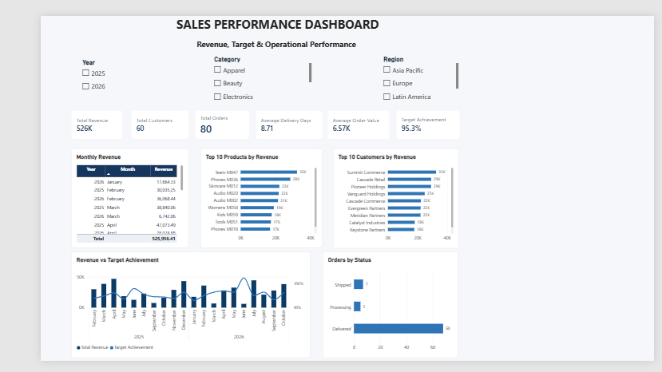
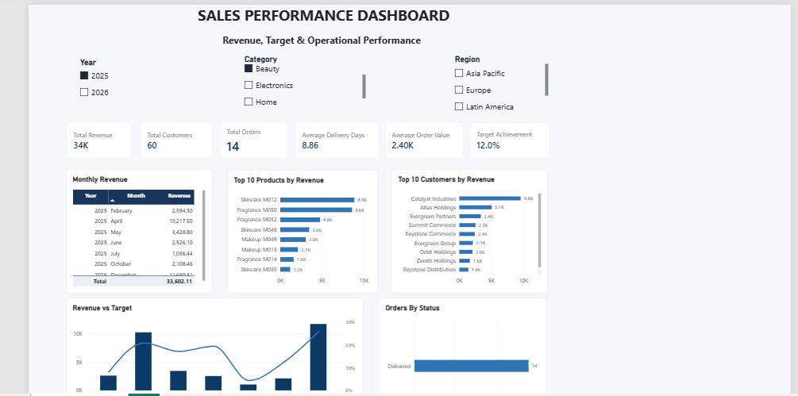
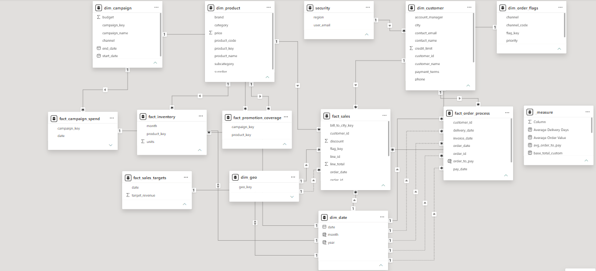
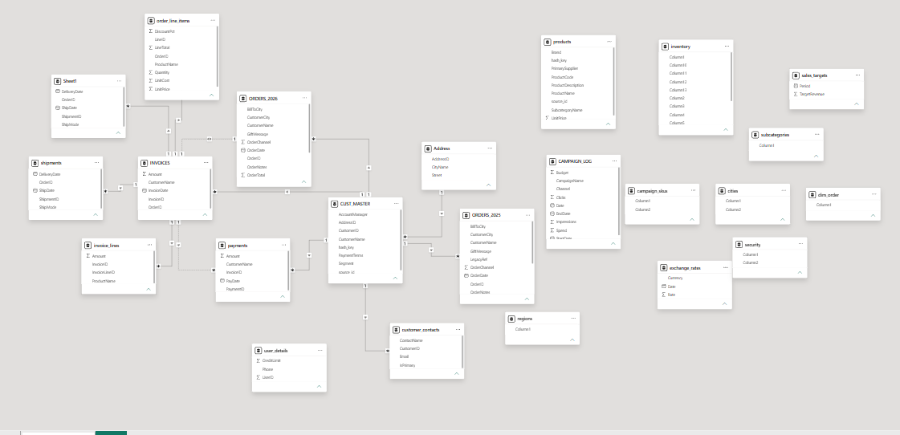

# Power BI Sales Data Modeling

## Project Overview
This project focuses on building a structured data model in Power BI using multiple raw Excel data sources. The objective was to transform inconsistent operational data into an analysis-ready model for sales reporting and business insights.

## Project Objectives
- Build a structured data model using fact and dimension tables.
- Establish and validate relationships between tables.
- Address data quality and missing-key issues.
- Create a dedicated Date Dimension.
- Develop DAX measures and business KPIs.
- Apply Row-Level Security (RLS) to control data access.

## Tools and Technologies
- Power BI
- Power Query
- DAX
- Microsoft Excel

## Key Work
- Cleaned and transformed raw data using Power Query.
- Designed fact and dimension tables.
- Created and validated table relationships.
- Generated and mapped keys between tables.
- Investigated missing dimension mappings and other data-quality issues.
- Developed measures for revenue, customers, orders, delivery performance, and target achievement.
- Built an interactive sales performance report.
- Implemented Row-Level Security (RLS).
  
## Report Preview

### Sales Performance Dashboard

### Filtered Sales Dashboard

### Power BI Data Model

### Measures Overview

## Key Learning
This project strengthened my understanding of dimensional data modeling, data quality, relationships, DAX, and the importance of building a reliable data model before creating business reports.
